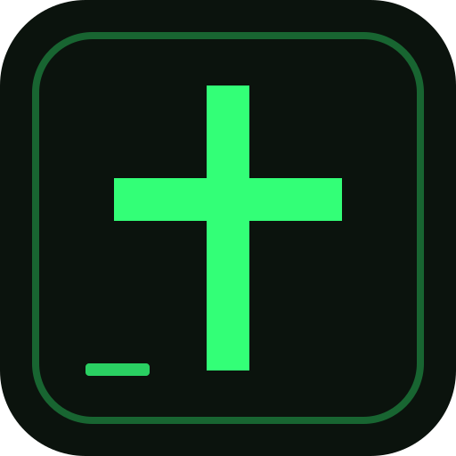
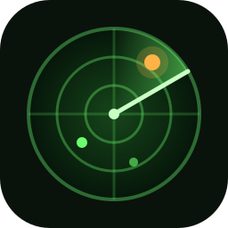

<div align="center">

# Patriot Apps

**Fifteen self-hosted apps for your Umbrel. One store, no accounts, no cloud.**

Everything you put in these apps stays on your own server.

</div>

---

## Add the store

1. In your Umbrel, open the **App Store**.
2. Click the **⋯** menu at the top right and choose **Community App Stores**. (The label varies a little between umbrelOS versions.)
3. Paste this address and click **Add**:

   ```
   https://github.com/PatriotCrypto/umbrel-patriot-apps
   ```

4. Open the **Patriot Apps** store and install whatever you like.

Umbrel re-checks community stores every so often, so a new app or update can take a few minutes to show up. Updates keep your data. Only uninstalling removes it.

---

## The apps

<table>
  <tr>
    <td align="center" width="25%"><a href="#zerodollar"><br><b>ZeroDollar</b></a><br><sub>Zero-based budgeting</sub></td>
    <td align="center" width="25%"><a href="#family-vault"><br><b>Family Vault</b></a><br><sub>Encrypted family papers</sub></td>
    <td align="center" width="25%"><a href="#rally-point"><br><b>Rally Point</b></a><br><sub>Preparedness planner</sub></td>
    <td align="center" width="25%"><a href="#bible-terminal"><br><b>Bible Terminal</b></a><br><sub>KJV study desk</sub></td>
  </tr>
  <tr>
    <td align="center"><a href="#pilot-log"><br><b>Pilot Log</b></a><br><sub>Flight log and backup</sub></td>
    <td align="center"><a href="#owner-log"><br><b>Owner Log</b></a><br><sub>Aircraft ownership records</sub></td>
    <td align="center"><a href="#builder-log"><br><b>Builder Log</b></a><br><sub>Kit-plane build log</sub></td>
    <td align="center"><a href="#skywatch-radar"><br><b>Skywatch Radar</b></a><br><sub>Live sky radar</sub></td>
  </tr>
  <tr>
    <td align="center"><a href="#skynet"><br><b>Skynet</b></a><br><sub>Mesh and ham radio hub</sub></td>
    <td align="center"><a href="#uplink"><br><b>Uplink</b></a><br><sub>Private chat and files</sub></td>
    <td align="center"><a href="#disc-ripper"><br><b>Disc Ripper</b></a><br><sub>DVD to Jellyfin</sub></td>
    <td align="center"><a href="#upod"><br><b>uPod</b></a><br><sub>Music player and iPod sync</sub></td>
  </tr>
  <tr>
    <td align="center"><a href="#cold-front"><br><b>Cold Front</b></a><br><sub>Local thermostat control</sub></td>
    <td align="center"><a href="#constellation"><br><b>Constellation</b></a><br><sub>Your network in 3D</sub></td>
    <td align="center"><a href="#advent-calendar"><br><b>Advent Calendar</b></a><br><sub>Christmas countdown for kids</sub></td>
  </tr>
</table>

---

## Money and home

### ZeroDollar


**Zero-based budgeting that lives on your node.** Plan your income, give every dollar a job until "Left to budget" reaches zero, and log spending in seconds with a one-line quick add (`45.20 kroger groceries`).

- Monthly bank reconciliation: upload a CSV or OFX/QFX statement and ZeroDollar matches it to what you entered by amount, date and payee, suggests tips and fees, and locks the month once the ending balance agrees.
- Sinking funds with goals, bill due dates, split transactions and transfers.
- Debt snowball or avalanche payoff planner.
- Paycheck Planning: your income and bills laid out by date with a running balance, a buffer, and a risk-of-overspending check.
- Insights: spending by group and item, monthly income, and income vs. spent over any period.
- Net worth tracker with goals and history, plus a Bitcoin wallet tracker for public addresses and xpubs (point it at your own Mempool app to keep lookups private).
- Import a month from EveryDollar's Budget Items CSV. Every item and group is editable.
- A Due this week list on the Budget page, plus backup, restore and CSV export.
- Optional password, and phone reminders through ntfy: weekly to review transactions, monthly to reconcile and plan the next month.
- Color-coded groups that carry through to Insights, a pay-day calendar for each income, and two looks: Daylight and Midnight.

*An independent community app. Not affiliated with or endorsed by Ramsey Solutions, EveryDollar or Umbrel, and it does not give financial advice.* · [Details](zerodollar-src/README.md)

### Family Vault


**A private, encrypted home for your family's important documents.** Passports, insurance policies, tax returns, wills, medical records and more, organized by category and by family member.

- Drop files into the Inbox and accept the suggested category with one click.
- Expiry reminders, stored contacts (attorney, doctor, agent), a Passwords category, a net worth tracker, and a printable emergency sheet.
- Everything is encrypted with AES-256-GCM using a key derived from your passphrase. The passphrase is never stored, so **if you forget it, nothing can be recovered**. A one-click encrypted backup is included.

[Details](family-vault-src/README.md)

### Rally Point


**Private preparedness and homestead planner.** Track what you have, how long it will last, and who does what.

- Inventory with lots and expiration dates; the Console shows days of food, water, fuel and power, your weakest links and a readiness score.
- Water and power planning (rain catchment, bleach dosing, solar, battery, generator fuel).
- Group tools: members, skills, tasks, watch roster, go-bags. Checklists, contacts, places and document expirations.
- Garden and animals with a frost-based sowing calendar.
- A PIN-protected encrypted vault, and a stealth mode that hides sensitive categories with one tap.

*An independent community app, not affiliated with or endorsed by Umbrel.* · [Details](rally-point-src/README.md)

### Bible Terminal


**A study desk for the King James Bible, read straight from Bitcoin.** A quiet, terminal-style reader that runs entirely on your Umbrel.

- A second translation alongside, search by word, phrase or prefix, 250,000 cross-references, Strong's Hebrew and Greek lookup, a timeline of Bible history, reading plans, bookmarks, highlights and notes you can export to Markdown, and a memory-card mode for learning verses.
- **Ask** a question in plain words and your own local AI model (Ollama) answers from the relevant verses only, with citations.
- The text was read from 66 Bitcoin inscriptions, and **Verify** re-checks every book against the blockchain on demand.
- Build a ready-to-flash SD card image for a Raspberry Pi Zero 2 W and it becomes a pocket Wi-Fi "Scripture hotspot" that serves the whole Bible with no internet.

No accounts, no tracking. Not affiliated with any publisher, church or ministry. · [Details](bible-terminal-src/README.md)

### Cold Front


**Take your thermostat back.** Local control of a Z-Wave thermostat (built for the Honeywell T6 Pro Z-Wave) with no cloud, no account and no company deciding what your house does.

- Your own weekly schedule, holds, away mode and safety limits. Changes made at the wall are noticed and either held until the next period or put back.
- Insights: furnace runtime, cycles, short-cycling, room vs. thermostat differences, humidity and cost.
- Add Z-Wave temperature and humidity sensors for other rooms, with an optional room-aware mode that nudges the setpoint toward a room you pick.
- Filter reminder with dates you set by hand, plus ntfy phone alerts for filter changes, lost and restored signal, freezing, no heat, low batteries and more. Every alert is off until you turn it on.
- An UmbrelOS-style home screen with a greeting, a customizable widget Dashboard (drag, resize, add and remove), a dock, light and dark modes, a clear temperature chart, water leak alerts, two Umbrel home-screen widgets, phone and desktop layouts, and a hidden surprise. Starts in Demo mode so you can try it before the hardware arrives.

You need a Z-Wave USB stick (800 series recommended); the [README](coldfront-src/README.md) walks through first-run setup. *An independent hobby project, not affiliated with Honeywell, Zooz, the Z-Wave Alliance or Umbrel.*

---

## Aviation

### Pilot Log


**Your flight log and logbook backup, kept on your own server.** A complete copy of your records on hardware you control, instead of only in someone else's cloud account.

- Photograph your paper logbook pages and file them by date.
- Import your ForeFlight logbook as a CSV (importing again only adds new flights) and export it back out in ForeFlight's format at any time.
- A full single-pilot logbook on top: live dashboard, 90-day landing currency, flight review and medical reminders, and progress toward sport, private, instrument or commercial minimums.
- Endorsements and a checkride packet, passenger currency, an aircraft page per tail, an airport map, a Preflight Risk Check (live weather and runway winds against your personal minimums, plus a PAVE score), and flight costs.

[Details](pilot-logbook-src/README.md)

### Owner Log


**Keep your aircraft's maintenance, compliance and costs on your own server.** One page answers whether the aircraft is legal and safe to fly today; the rest keeps the evidence.

- Inspections and recurring maintenance on hours, calendar months or both. Signing an item off writes a logbook entry, moves the due date and records the cost.
- Squawks with severity and a grounding flag; airworthiness directives and service bulletins with recurring intervals and compliance proof.
- VOR checks with the 30-day IFR window, equipment and STCs.
- What an hour really costs: variable spending, fixed costs spread over expected hours, and money set aside for the overhaul.

[Details](owner-log-src/README.md)

### Builder Log


**Track your kit-plane build on your own server.** Built for Van's RV kits, and works for any kit aircraft.

- Log every shop session with hours, notes, photos and helpers, with a work timer and a phone-friendly quick-add page for the shop.
- Completion tracking per kit and per section, so the dashboard always shows where the aircraft stands.
- Photos with numbered annotations, inventory with packing-list CSV import, costs by category against a budget (with receipts), and storage for plans, bulletins and paperwork.
- Insights: hours by month and per person, longest sessions, cost per build hour and a straight-line finish estimate.

[Details](builder-log-src/README.md)

### Skywatch Radar


**A live radar screen for the aircraft around your home**, using ADS-B data from the Wingbits network. Go full screen and leave it on a spare monitor.

- Choose a view: a WW2 plot-room scope with a rotating sweep, a modern approach-control screen, a holographic deep-field display, or a pixel-art Omniverse.
- Paces itself against your Wingbits API plan so a slow budget still looks live.
- Spotter log and life list, stats and heatmap, a watchlist, and alerts for emergency squawks, military traffic and low aircraft (with optional ntfy push).

You need a Wingbits API key (station operators get a free Starter plan). Until you add one, Skywatch runs on simulated demo traffic. *An unofficial community app.* · [Details](skywatch-src/README.md)

---

## Radio and networking

### Skynet


**Your Meshtastic mesh and ham radio in one control room.**

- **Meshtastic:** every node on a map with trails and a coverage heat map, battery and signal, alerts when a node goes quiet, and chat with the mesh from your browser. Connects to a node over Wi-Fi or Ethernet, and includes a demo mesh so you can try everything first.
- **Ham radio:** contacts, callsigns and frequencies in one place. Build a channel list for a Baofeng (or any CHIRP-supported radio) and export it as a CHIRP CSV, import your radio's list, keep a logbook, and export ADIF.
- Four looks, and a hidden surprise.

*An independent hobby project, not affiliated with Meshtastic, Baofeng, CHIRP or Umbrel.* · [Details](skynet-src/README.md)

### Constellation


**See every device on your network, in 3D.** A quiet observatory for your home Wi-Fi.

- A live 3D map with your gateway in the middle and every device on one ring you can rearrange by dragging. Tag devices by room or person.
- Name devices, and track when each one is online, for how long, and how your internet is holding up. Includes a speed test.
- Click a device for a glass details card. Umbrels and Bitcoin nodes get their own globes with the Umbrel and Bitcoin logos.
- Six looks, including Glass and Daylight. Monitoring only: it cannot block devices or show per-device data use. It has its own password because it runs on your host network.

*An independent hobby project, not affiliated with Starlink, SpaceX or Umbrel.* · [Details](constellation-src/README.md)

### Uplink


**A private chat and file link between your Umbrel and a friend's.** It runs over Tailscale with no company server, no account and no cloud.

- Messages wait and are delivered when the other station comes back online.
- Files of any size are sent in pieces and resume if the link drops.
- Everything between the two stations is end-to-end encrypted on top of Tailscale's own encryption.

Both of you need the Tailscale app on your Umbrels; the [README](uplink-src/README.md) shows two easy ways to set it up.

---

## Family

### Advent Calendar


**A Christian Christmas countdown for kids.** A door a day from December 1 to 25, each with an animated, musical surprise and a verse from the Christmas story.

- North Pole spy cams that change as Christmas gets closer, then the Christmas Eve launch and a Santa tracker that reaches your town at bedtime.
- Letters to Santa (he writes back, no AI), a Christmas list parents can read, and the Nice List Scanner with the list set by parents day by day.
- Carol music box, Snowball Toss, Reindeer Quiz, hidden elves, badges, five looks and dozens of secrets.
- Several children share one calendar. All sounds are made by the app; nothing leaves your Umbrel.

No Umbrel login in front so kids can open it on any home device; the Grown-ups page has a PIN. · [Details](advent-src/README.md)

---

## Media

### Disc Ripper


**Pop in a DVD and walk away.** It notices the disc, works out whether it is a movie or a TV season, rips it with MakeMKV at full quality, names it the way Jellyfin expects, and ejects it.

- Movies go to `Movies / Name (Year) / Name (Year).mkv`; TV discs are split into episodes under `TV Shows / Show (Year) / Season 01 /`, with numbering continuing from disc to disc.
- If it is not sure what a disc is, it asks on its status page (or you can switch on automatic mode).

You need a USB DVD drive and a free MakeMKV beta key (the app gets it for you from its settings). After installing, give the app your **Media** folder in Umbrel's storage settings. Only rip discs you own, for your own use. Not affiliated with MakeMKV, IMDb or TVmaze. · [Details](disc-ripper-src/README.md)

### uPod


**Your music player, visualizer and iPod sync, all on your Umbrel.** Play your library in the browser with full-screen visualizations in the style of early-2000s media players, your own playlists, and skins. Music is sorted by genre automatically, even when the tags are messy.

- A one-button duplicates finder moves extra copies to a trash folder you can restore or empty. One copy of every song always stays.
- The original trick is kept: plug in an old iPod and copy albums, songs or a playlist onto it. FLAC, Ogg and Opus are converted to AAC, covers are copied, and the iPod's database is backed up before every sync.
- Built and tested for the iPod nano 5th generation. That model needs one sync with iTunes (or Apple Devices or Finder) first so its database signature is learned.

[Details](ipod-sync-src/README.md)

---

## Good to know

- **Your data stays home.** Every app stores its data in its own folder on your Umbrel. There is no telemetry and no accounts. Where an app can reach an outside service (a price lookup, a push notification, an API key you supply), that feature is optional and says so.
- **Login.** Umbrel's own sign-in protects each app. Do not expose an app's port directly to the internet.
- **Back up what matters.** Use each app's own backup or export for anything you cannot replace.
- **Independent projects.** These are community apps made by a hobbyist. None is affiliated with or endorsed by Umbrel or any company named above, and none gives financial, legal or medical advice.

## How the repository is laid out

| Folder | What is in it |
| --- | --- |
| `umbrel-app-store.yml` | Store id (`patriot`) and name |
| `patriot-<app>/` | The Umbrel listing for each app: manifest, compose file and icon |
| `<app>-src/` | The app's source code, its own README and tests |
| `scripts/`, `.github/workflows/` | Helpers for building the uPod image |

Each app's image is published to the GitHub Container Registry and pinned by digest in its compose file.

## Feedback

Found a bug or have an idea? [Open an issue](https://github.com/PatriotCrypto/umbrel-patriot-apps/issues).

## License

[MIT](LICENSE). Copyright (c) 2026 PatriotCrypto.
