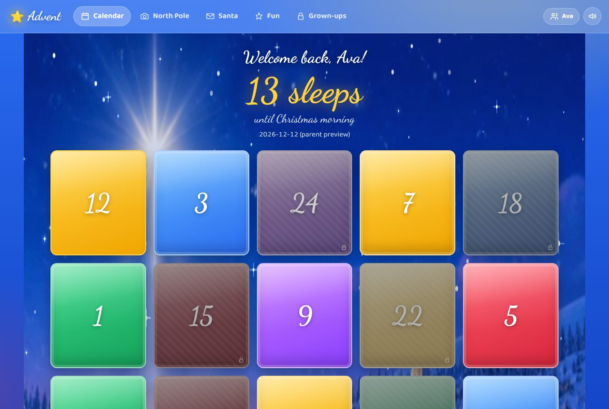
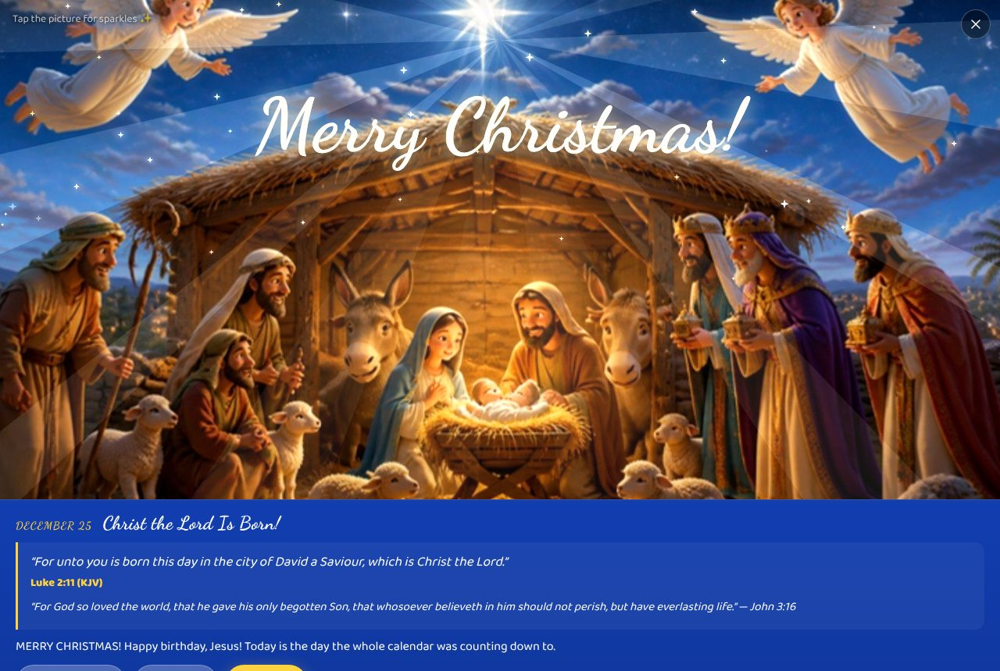
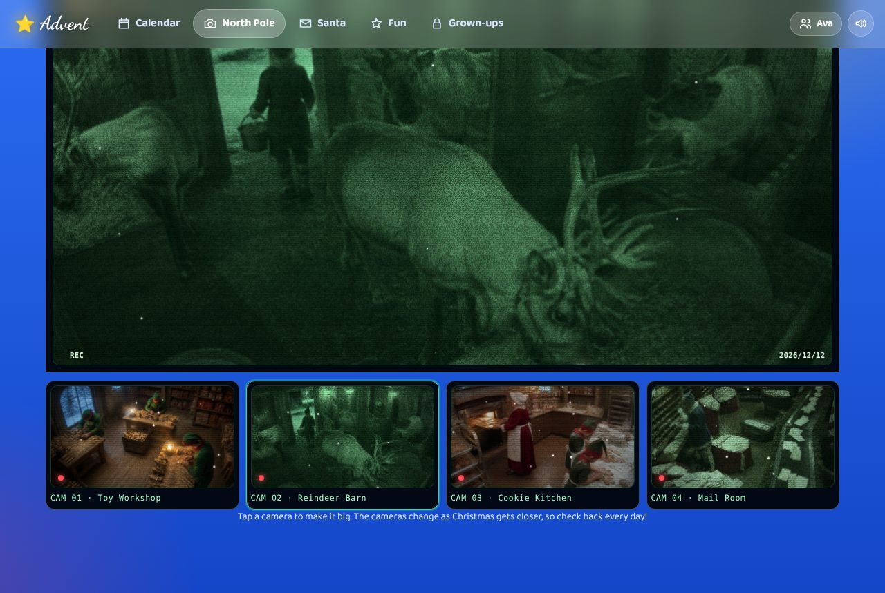
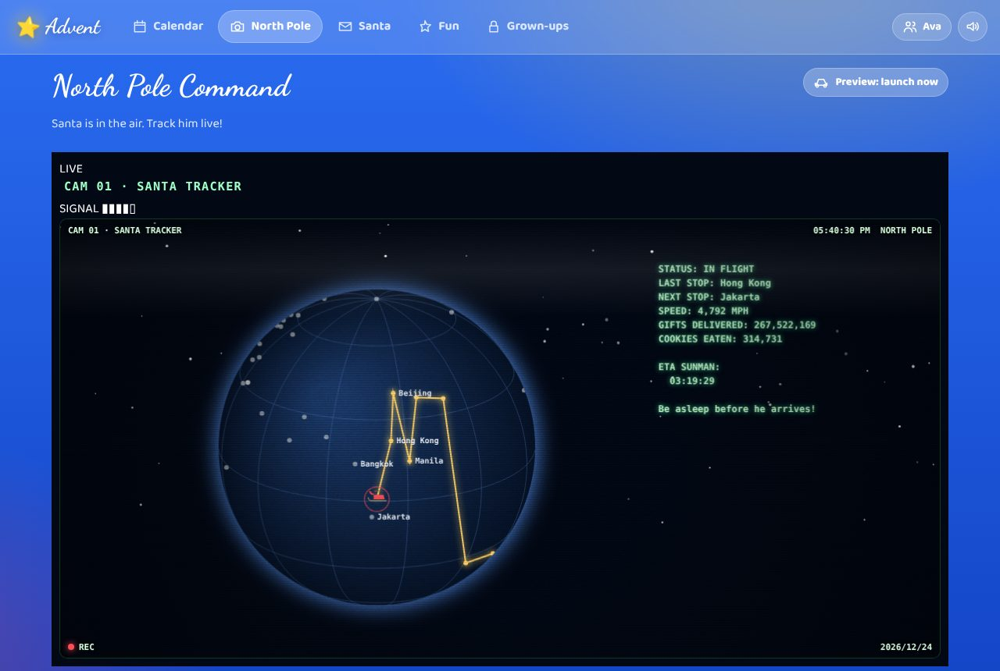

# Advent Calendar

A Christian Christmas Advent calendar for Umbrel, made for kids. A door a day from December 1 to 25, each with an animated, musical surprise and a verse from the Christmas story. Plus North Pole spy cams, a Christmas Eve launch and Santa tracker, letters to Santa, the Nice List Scanner, games, badges and secrets.






## What it does

- **25 doors.** Each day's door opens on its date (locked ones wobble and say "not yet"). Behind it: a full-screen animated scene with sound, a King James verse that walks through the Christmas story in order, and a short kid-friendly note. Tap the picture for sparkles. Christmas Day is the full Nativity with angels and fireworks.
- **North Pole Command.** Four "live" cams with a spy-cam look. Early December: the toy workshop, the reindeer barn, the cookie kitchen and the mail room. From the 16th: Santa checking his list, the wrapping room, reindeer training. From the 21st: loading the sleigh, the harness bay, the weather radar. Christmas Eve at 5 PM: liftoff, then the **Santa Tracker**, a globe with Santa's route, stops, gifts delivered and the ETA to your town, which he reaches at the bedtime you set. Christmas Day: Santa snoring by the fire.
- **Santa's Letter Desk.** Kids write to Santa and he writes back. Anything they say they would like goes on their Christmas list, which parents can read. Santa's replies are written in advance (no AI, no internet) and always point back to Jesus when asked what Christmas is about.
- **Nice List Scanner.** A hand scanner that reports Nice or Naughty for today. Parents set it per child, per day, behind the PIN.
- **Fun & Games.** Carol jukebox (a music box playing public-domain carols), Snowball Toss, Reindeer Quiz, the Christmas Story so far, badges, a hidden elf on the calendar every day, and secrets: typed magic words, a famous old video-game code, taps on the star, midnight bells on Christmas Eve, and more.
- **Several children.** Each child has their own doors, letters, list, badges and elf count. Switch with the name chip at the top.
- **Five looks.** Bethlehem Night, Cozy Cabin, Candy Cane, Winter Frost and North Pole Command.
- **Audio.** Every sound (bells, chimes, Santa's laugh, hooves, fireworks, the music box) is synthesized in the browser with the Web Audio API. Nothing is downloaded or recorded.

## For parents

- First run asks for the children's names, a **parent PIN** (4 to 8 digits), your town and Christmas Eve bedtime, and a look.
- The **Grown-ups** tab (PIN) manages children, the Nice list by day, wish lists and letters, the PIN, and a **preview date** so you can see any day of December (and test the launch) before the kids do. Clear the preview afterwards!
- The app has no Umbrel login in front of it so children can open it from any phone or tablet on your home network. Only the Grown-ups page is protected, by the PIN. Do not expose the port to the internet.
- Dates follow the device's clock. The calendar starts on December 1 and stays open through Christmas; after that it rests until next Advent.

## Artwork and fonts

The door pictures, the calendar backdrop and the camera "footage" are still images generated with Canva's AI image tool and animated in the browser with canvas layers (light, sparkle, snow, grain, night-vision tint, camera drift). Headings use [Dancing Script](https://fonts.google.com/specimen/Dancing+Script) and body text uses [Baloo 2](https://fonts.google.com/specimen/Baloo+2), both under the SIL Open Font License and bundled in `app/public/fonts/`.

## Privacy

Everything stays on your Umbrel. No accounts, no telemetry, no outside requests at all. Letters and wish lists are stored in the app's own data folder.

## Development

```
cd app
npm test
DATA_DIR=./.dev-data PORT=3981 node server.js
```

Zero dependencies: Node 22, plain JavaScript, canvas and Web Audio. Verses are from the King James Bible (public domain); carols are traditional public-domain tunes transcribed as note sequences.

MIT licensed. An independent project, not affiliated with Umbrel.
