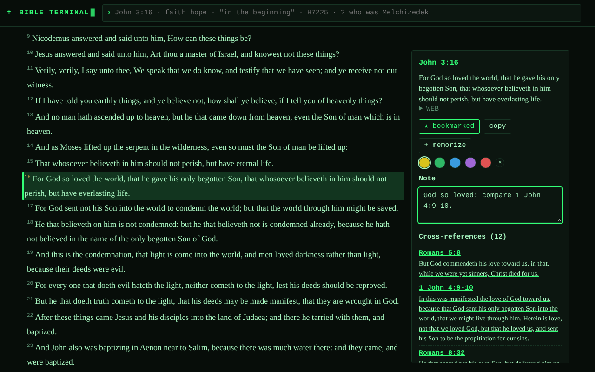

# Bible Terminal

A quiet, terminal-style study desk for the King James Bible, for [Umbrel](https://umbrel.com). Runs entirely on your own server: no accounts, no tracking, no outside services unless you choose them.



## What it does

- **Read** any chapter, with the World English Bible beside it. Click a verse to bookmark, highlight, write a note, see cross-references, or add it to your memory cards.
- **Search** words, phrases (`"in the beginning"`), prefixes (`lov*`), exclusions (`grace -works`) and scopes (`in:john love`), with a book-by-book chart of where matches fall.
- **Words**: Strong's Hebrew and Greek dictionaries.
- **Timeline**, **reading plans**, **memorize** (spaced-repetition cards), **notes** exportable to Markdown.
- **Ask**: type a question; the app finds the best passages in the browser and your own **Ollama** model answers from those verses only, with citations.
- **Verify**: re-downloads the 66 Bitcoin inscriptions the text was read from and checks every book, byte for byte.
- **Four looks** (phosphor, amber, scriptorium, blueprint): the ◐ look button in the top bar cycles them, so they work on the hotspot too. There are two hidden extras to find.
- **Hotspot**: builds a ready-to-flash SD card image for a Raspberry Pi Zero 2 W, which becomes a pocket Wi-Fi that serves the whole Bible offline.

More screenshots are in [`docs/screenshots`](docs/screenshots). The Ask screenshot uses a scripted stand-in instead of a real model.

## About the text

The KJV text was read from 66 Ordinals inscriptions on Bitcoin (transaction ids in `app/data-src/txids.json`) and is shown **exactly as inscribed**, without corrections. About 90 verses differ in tiny spelling or punctuation details from other KJV editions. Bitcoin proves what was inscribed, not that it matches any particular printing.

## Install on Umbrel

1. In Umbrel, open **App Store → ⋯ → Community App Stores** and add `https://github.com/PatriotCrypto/umbrel-patriot-apps`.
2. Install **Bible Terminal** from that store.
3. Optional: in **Settings** inside the app, enter your Ollama address and model to turn on Ask.

## Layout

| Path | What |
|---|---|
| `umbrel-app-store.yml`, `bbtrm-bible-terminal/` | the Umbrel community store entry |
| `app/` | the app (Node 22 + Express, plain browser JS, no build step) |
| `app/data/` | built data (KJV, WEB, cross-references, Strong's, timeline, plans) |
| `app/scripts/build-data.mjs` | rebuilds `app/data/` from Bitcoin and the open datasets |
| `app/hotspot/` | what runs on the Pi |

## Develop

```
cd app
npm ci
npm test
DATA_DIR=/tmp/bt PORT=3953 node server/index.js
```

Build and publish the image (multi-arch):

```
docker buildx build --platform linux/amd64,linux/arm64 -t ghcr.io/patriotcrypto/bible-terminal:0.1.0 --push app
```

Then put the image digest into `bbtrm-bible-terminal/docker-compose.yml`.

## Notes and limits

- The hotspot image builder downloads Raspberry Pi OS (about 500 MB) and needs about 7 GB free. It is **experimental**: it has been tested against a synthetic image, not on every Pi.
- Ask needs a model you run yourself; it never calls a hosted AI.
- Not affiliated with any publisher, church or ministry. See [`NOTICE.md`](NOTICE.md) for data licenses (cross-references CC BY, Strong's CC BY-SA, KJV and WEB public domain).

MIT licensed code. See `LICENSE`.
