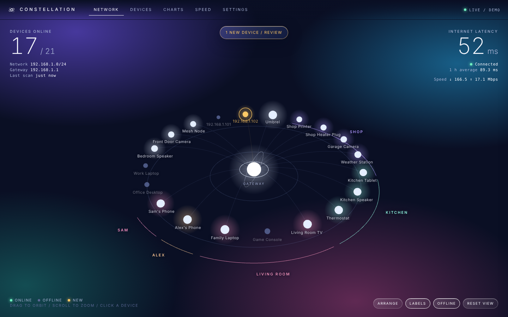
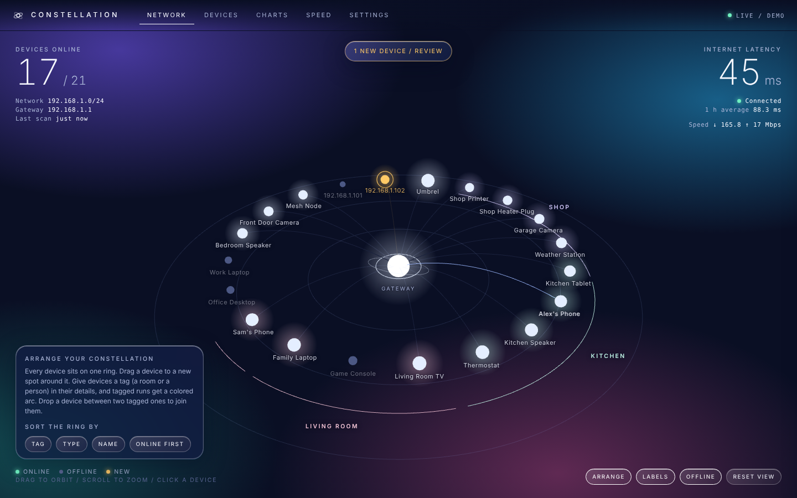
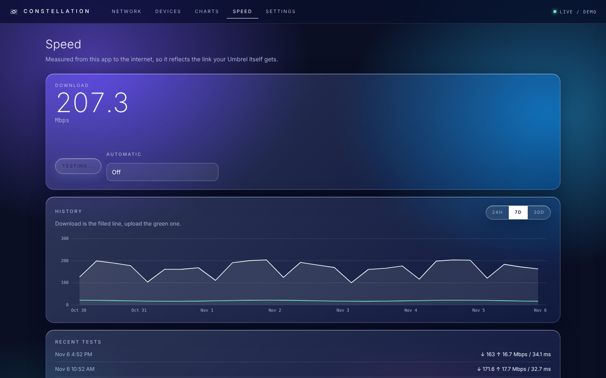

# Constellation

A quiet observatory for your home network, for Umbrel. See every device on your Wi-Fi as a live 3D map,
name them, and watch who is online, for how long, and how your internet is holding up.

## What it does

- **Network**: a 3D view of your gateway, a dish and satellite train, and every device on three orbits.
- **Devices**: searchable list, rename, set a type, add notes, mark as recognized, hide, forget.
- **Charts**: devices online, internet latency (avg, p95, loss), presence timeline, time online, activity.
- **One constellation**: every device sits on a single ring around your gateway. Turn on Arrange, then drag devices to any spot on the ring, or sort the ring by tag, type, name or online status. Give a device a tag (a room or a person) and tagged runs get a colored arc with its name; drop a device between two tagged ones to join them.
- **Speed**: one-tap download, upload and latency test, optional automatic tests every 3 to 24 hours, with history. Measured from the Umbrel to Cloudflare's public test servers.
- **Alerts**: optional push through ntfy when an unfamiliar device joins.
- Six looks (Orbit, Glass, Daylight, Mission, Mars, Polar), a hidden surprise, no sound.

## What it cannot do (on purpose, and by physics)

- It does **not block** devices or set schedules. The stock Starlink router has no such controls.
- It does **not show data usage per device**. The router does not expose it. "Usage" here is time online and sessions.
- Phones with private Wi-Fi addresses can appear as a new device when the address rotates.
  Turning the private address off for your home network fixes that.

A speed test moves as much data as your link allows for about 14 seconds, so on a fast connection that is a few hundred MB.
Internet latency checks pause while it runs.

## How it works

Runs on the host network, sweeps the local subnet with UDP, reads the kernel ARP table, and resolves names
with mDNS, reverse DNS and NetBIOS. Vendors come from the IEEE OUI list. Uptime is counted only over time the
app was actually watching, so downtime of the app is never blamed on a device.

Data lives in `/data` as a JSON file with daily backups. Zero runtime dependencies (Node 22).

## Security

Host networking means Umbrel's login proxy is not in front, so Constellation has its own password
(scrypt, set on first visit) and a one-time recovery code. Sessions are HttpOnly, SameSite=Strict cookies,
with login throttling, CSRF header checks and a strict Content-Security-Policy.

## Development

    cd app
    npm test
    CONSTELLATION_DEMO=1 CONSTELLATION_NO_AUTH=1 node server.js   # synthetic network on :3971

Rebuild the 3D bundle: `cd scene && npm install && npm run build`.

## Disclaimer

Independent hobby project by PatriotCrypto. Not affiliated with, endorsed by, or sponsored by Starlink,
SpaceX or Umbrel. See NOTICE.md for third-party licenses. MIT.
