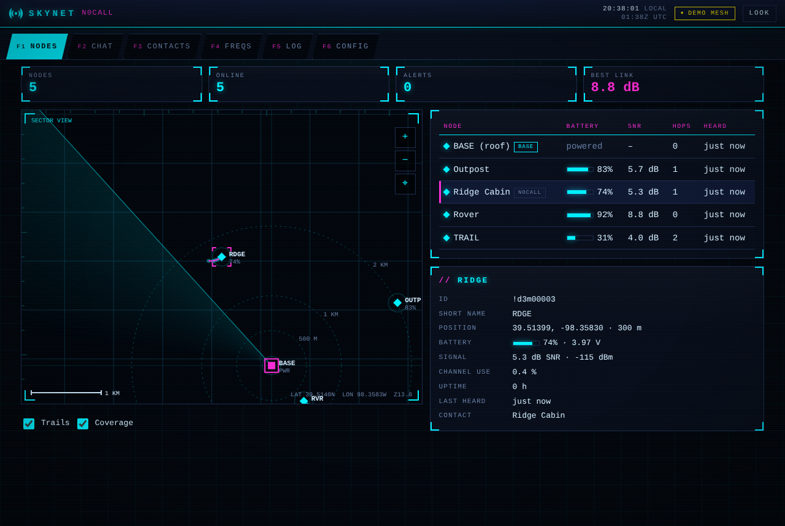
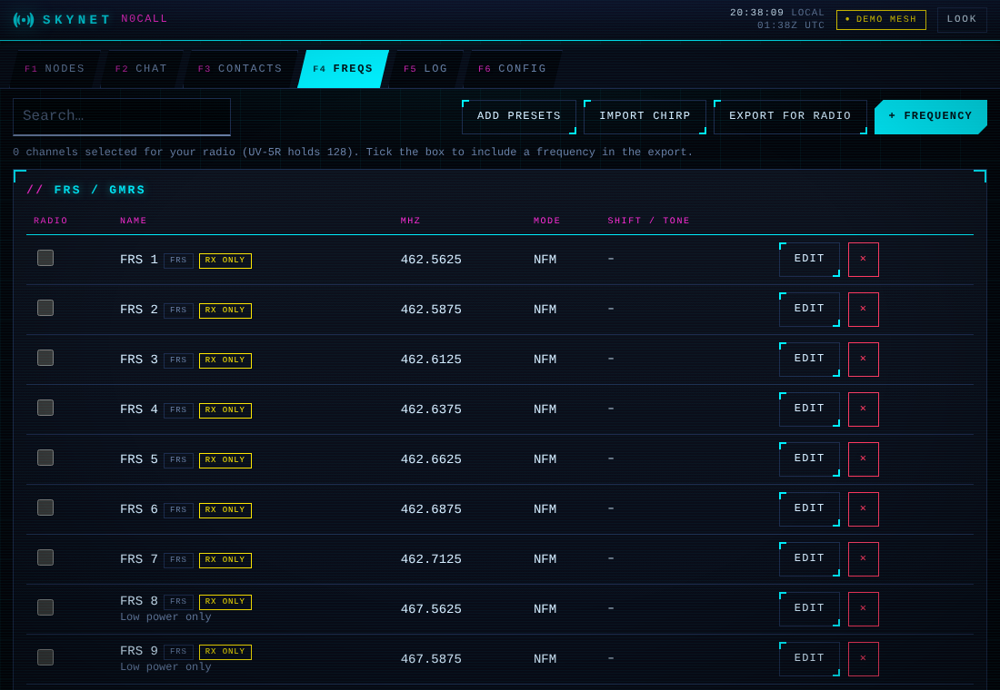
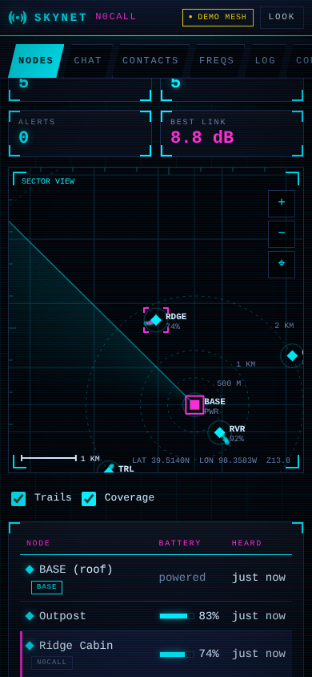
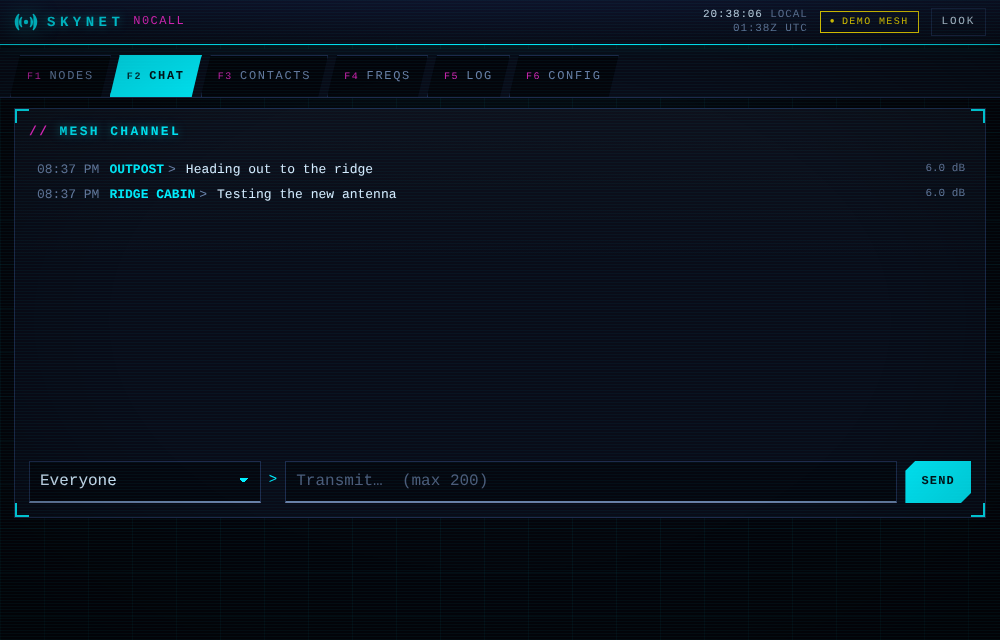
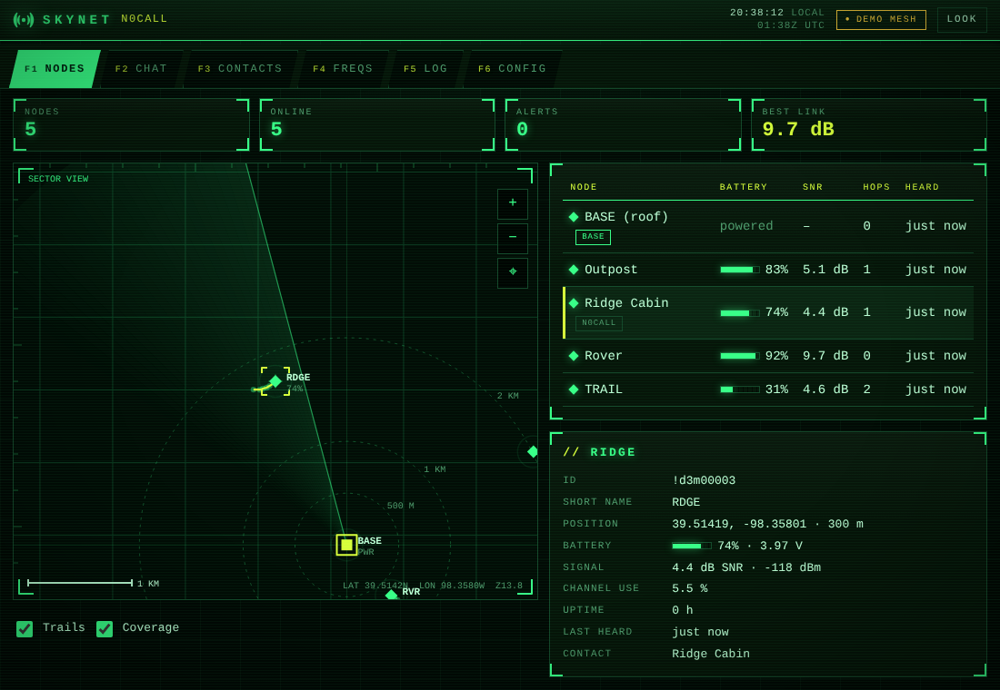
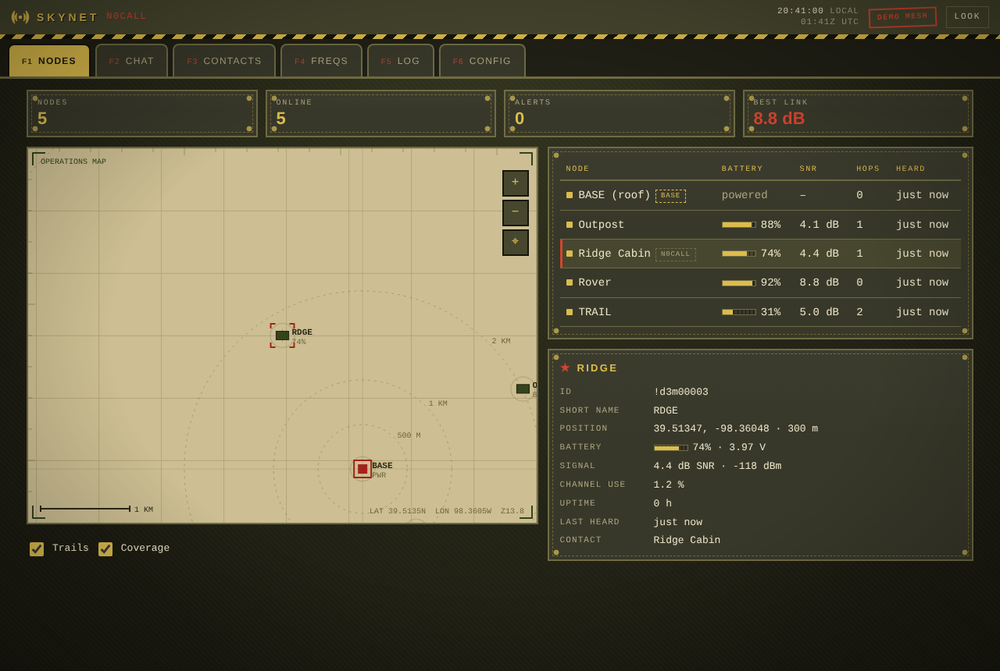
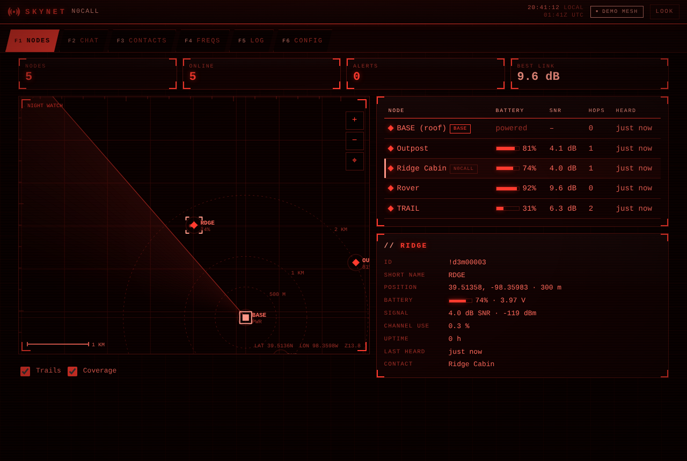
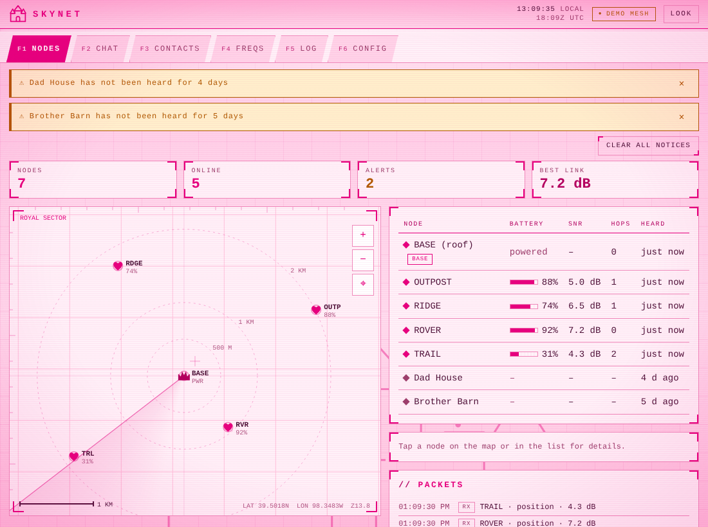

# Skynet for Umbrel

A control room for your **Meshtastic mesh** and your **ham radio**, running on your own [Umbrel](https://umbrel.com).



Skynet is a joke name for a radio network that watches the sky. It is an independent hobby project (see the no-affiliation note at the bottom).

## What it does

**Meshtastic**
- Every node on a map with trails, range rings and a coverage heat map showing where your portable nodes were heard from the base
- Battery, signal (SNR/RSSI), hops and last-heard for each node
- Alerts when a node goes quiet or its battery runs low
- Chat: a shared **Everyone** feed plus separate **Private** conversations with each node, with history kept on your Umbrel. Archive messages (or have them archived automatically), restore them, or delete them for good
- Connects to a node over your network (Wi-Fi or Ethernet). A built-in **demo mesh** lets you try everything with no hardware

**Ham radio**
- Contacts: names, callsigns, Meshtastic node IDs, groups and notes, all in one address book
- Frequency database: repeaters, simplex and calling frequencies, FRS/GMRS, MURS, NOAA weather, plus listen-only marine, aviation and public-safety channels, with one-click presets
- Pick the channels you want in your handheld, then **export a CHIRP CSV** (Baofeng UV-5R and friends); **import** your radio's current list from CHIRP
- Logbook with **ADIF export**
- Backup and restore of your own data

A cyberdeck-style HUD (corner brackets, scanlines, radar sweep, F-key tabs, UTC clock) in five looks: **Cyberdeck** (default), **Phosphor** (green terminal), **Battlefield** (WW2 field-command: olive drab, brass, rivets, parchment operations map, rubber-stamp status), **Night Red** (red light only, to protect your night vision) and **Princess Deck** (the cyberdeck HUD in bright pink, with a wireframe castle, hearts for nodes and a crown for the base). Press F1 to F6 to jump between screens. And one hidden surprise.

| Frequencies | Phone | Chat |
|---|---|---|
|  |  |  |

| Phosphor | Battlefield | Night Red |
|---|---|---|
|  |  |  |



The screenshots show fictional demo stations.

## Install

1. In Umbrel, open the App Store, tap the three dots, choose **Community App Stores**, and add `https://github.com/PatriotCrypto/umbrel-patriot-apps`.
2. Install **Skynet** from that store.

## Connect your Meshtastic node

Skynet talks to a node's TCP API (port 4403), so the node needs a network connection:

1. Give your node Wi-Fi (or Ethernet, on boards that have it) using the Meshtastic app or CLI, on the same network as your Umbrel.
2. Give it a fixed address in your router so it does not change.
3. In Skynet, open **Settings**, choose **Live**, enter the node's address, and save.

Nodes that only have Bluetooth or USB (for example a plain Wio Tracker L1) cannot be used as the connection point, but they still show up on the map through any networked node that hears them. The usual setup is one fixed node on the roof with Wi-Fi or Ethernet, plus any number of portable nodes.

## Use it with a Baofeng

A handheld like the UV-5R has no network connection, so Skynet is the planning side:

1. Build your list in **Freqs** and tick the channels you want in the radio.
2. **Export for radio** to get a CHIRP CSV.
3. Open the CSV in [CHIRP](https://chirpmyradio.com) and upload it with your programming cable.

To find repeaters near you, CHIRP can pull them from RepeaterBook for your area (look under its Radio menu for the data-source option). Save the result as a CSV and use **Import CHIRP** in Skynet.

Frequencies for services your radio is not certified for (FRS, GMRS, MURS) are marked **RX only** so you remember to listen without transmitting. You are responsible for operating within your license and the rules for each service.

## Privacy and security

- Everything is stored on your Umbrel (`skynet.json` in the app data folder). No accounts, no analytics, no external scripts, fonts or images.
- Access is protected by your Umbrel login.
- The link to your Meshtastic node is plain TCP on your local network, as the node's own API works. Keep the node on a network you trust.
- The OpenStreetMap map background is **off by default**. If you switch it on, your browser downloads tiles from openstreetmap.org.

## Status

v0.1.0. Tested against a mock node that speaks the Meshtastic TCP framing, plus unit and API tests. Real-hardware testing against a live node is the next step, so expect rough edges there. Not yet built: pushing a channel list straight to the radio (CHIRP does that), Bluetooth/serial node connections, MQTT.

## Development

```
cd app
npm install
npm test
DATA_DIR=./data PORT=3959 npm start
```

Release routine: bump `app/package.json` and `skynt-skynet/umbrel-app.yml`, then

```
docker buildx build --platform linux/amd64,linux/arm64 -t ghcr.io/patriotcrypto/skynet:X --push .
```

in `app/`, pin the manifest-list digest in `skynt-skynet/docker-compose.yml`, commit and push.

## License and notices

MIT. See [LICENSE](LICENSE) and [NOTICE.md](NOTICE.md). Skynet contains its own small Meshtastic protocol reader and bundles no Meshtastic code.

Not affiliated with or endorsed by Meshtastic, Baofeng, CHIRP, Umbrel, or any film or TV franchise. All names belong to their owners.
