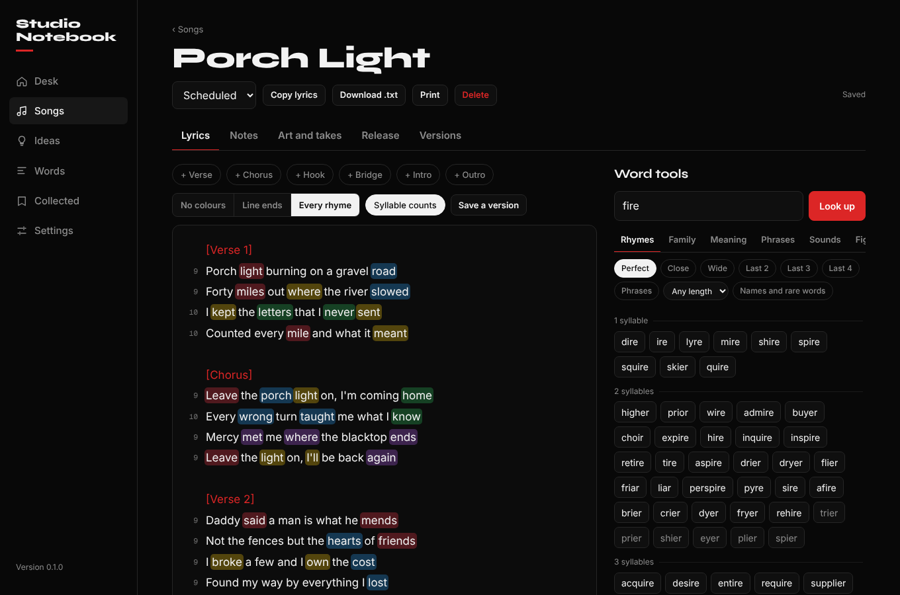
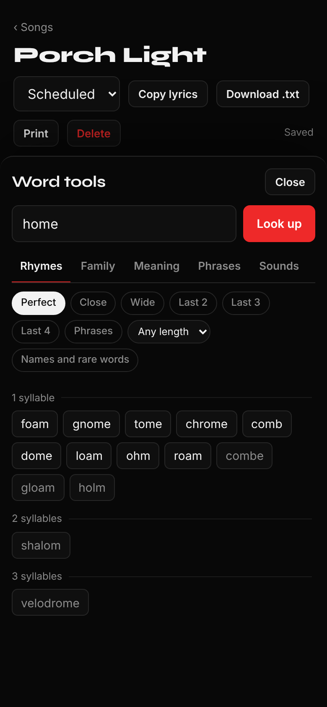
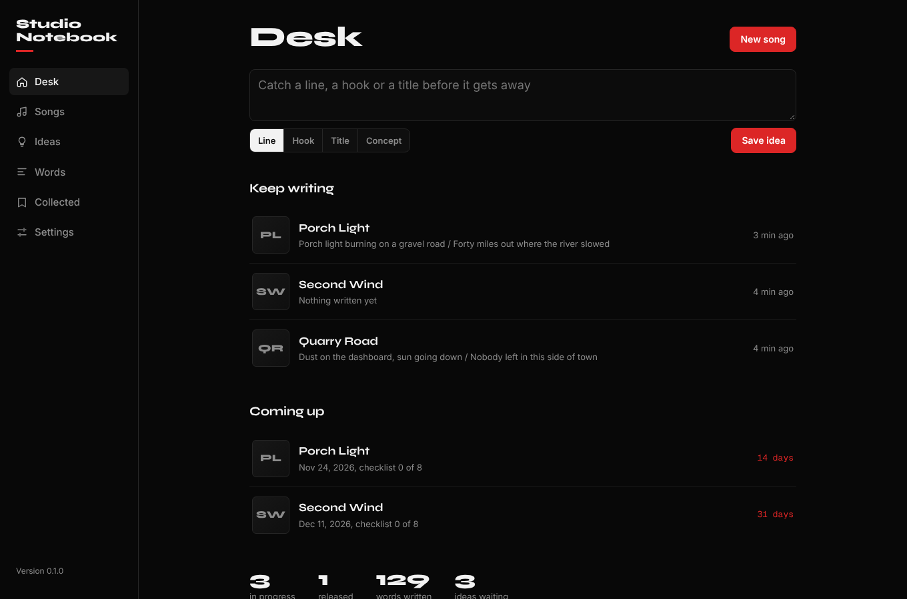

# Studio Notebook

A private songwriter's notebook for your Umbrel. Write lyrics, find the right
word, keep every draft, and follow each song to its release day. No account,
no subscription, and nothing you write leaves your server.



## What it does

**The lyric sheet**

- Counts the syllables in every line, so you can see at a glance which bars run long.
- Colours the words that rhyme. Choose line endings only, or every rhyme in the verse to see internal rhymes.
- Shows characters, words, lines and syllables, and warns you when the lyrics pass a character limit you set (3,000 by default, which is where many AI music tools cut off).
- One-tap section names such as `[Verse 2]` and `[Chorus]`.
- Saves as you type. A copy of the lyrics is kept before the first edit of each day, and you can save a named version before a big rewrite. Compare any version with the current lyrics line by line, or go back to it.

**Word tools** (all offline)

| Tab | What you get |
| --- | --- |
| Rhymes | Perfect, close and wide rhymes; matches on the last 2, 3 or 4 syllables for multi-syllable rhymes; phrases that rhyme. Filter by syllable count, and switch names and rare words on or off. Works on short phrases too. |
| Family | A wide net of related words from the Moby Thesaurus, everyday words first. |
| Meaning | Definitions with an example, words that mean the same, opposites and related words. |
| Phrases | About 65,000 phrases and sayings, searched by any word in them. |
| Sounds | Words that open with the same sound, for alliteration. |
| Figures | A short list of similes, oxymorons, onomatopoeia, intensifiers and sayings. |
| Bible | Search the King James Bible by word, or put a phrase in quotes. |

Double-click a word in your lyrics to look it up. Tap any result to drop it in
at the cursor, collect it for the song, or add it to a collection you keep
across songs.



**Around the song**

- Notes: the story behind the lyrics, sound and style, tempo, key, voice, tags.
- Art and takes: cover art plus audio files (MP3, WAV, M4A, AAC, FLAC, OGG, OPUS, AIFF) that play back next to the lyrics.
- Release: status, release date, a checklist you can change, links, ISRC and UPC.
- Ideas: catch a line, hook, title or concept, then start a song from it.
- Desk: what you were last writing, and what is coming out next.



**Also**

- Import plain text files as songs. Download any song, or all lyrics, as text.
- Backup and restore as a single JSON file.
- Four looks: Studio, Analog, Legal Pad and Midnight.
- One hidden surprise.

**Releases, Spotify and Apple Music**

- A calendar of scheduled and released songs. Pick a day to schedule a song.
- A suggested next release date: a Friday, a steady gap after your latest
  song (you choose the gap), at least three weeks away, and clear of the
  Christmas and New Year weeks and Black Friday. It is common advice for
  independent releases, not inside knowledge of anyone's algorithm.
- Add your artist links in Settings and press Sync. Songs found on the
  services are matched to your notebook by title, marked live, and filled in
  with links, release dates and missing cover art. Apple Music is read from
  Apple's public lookup service. Spotify shows only your current top tracks
  unless you add a free Spotify API key, which lets it read all of them.
  Sync is the only time the app goes online.
- The five words you use most, on the Desk.

## What it does not do

- It does not write lyrics for you, and there is no AI in it.
- No pop-culture dictionary, and the figures-of-speech list is short and hand-picked.
- No recording from the microphone. Browsers only allow that on secure (https) pages, and Umbrel apps open over plain http. Record elsewhere and add the file as a take.
- One writer. There are no separate users or shared editing.

## How it works

- Node 22 with no npm packages at run time. The front end is plain JavaScript modules.
- Songs, ideas and collections are stored in `db.json` in the app's data folder, with a rolling seven-day copy in `backups/`. Versions are in `versions/`, and cover art and audio in `files/`.
- The word data is built when the Docker image is built, from the CMU Pronouncing Dictionary, WordNet, the Moby Thesaurus and SCOWL. See [NOTICE.md](NOTICE.md) for sources and licenses.
- Each word data set loads the first time you use it and is dropped again after 20 minutes without use. Expect roughly 150 MB of memory while you write, and up to about 300 MB with every tool open.
- Umbrel's own sign-in protects the app. The container runs as an unprivileged user with a read-only file system and no extra capabilities.

## Privacy

Nothing is sent anywhere. The app makes no outside requests at all: the
fonts, the dictionaries and the Bible text are inside the image.

## Development

```
cd app
npm ci --ignore-scripts
curl -sSLO https://registry.npmjs.org/moby/-/moby-1.1.2.tgz
tar -xzf moby-1.1.2.tgz package/words.txt
node scripts/build-data.js --moby package/words.txt
npm test
npm start        # http://localhost:3983
```

## Disclaimer

Studio Notebook is an independent hobby project. It is not affiliated with or
endorsed by MasterWriter, Suno, DistroKid, Spotify, Apple or Umbrel.

## License

[MIT](LICENSE). Copyright (c) 2026 PatriotCrypto.
