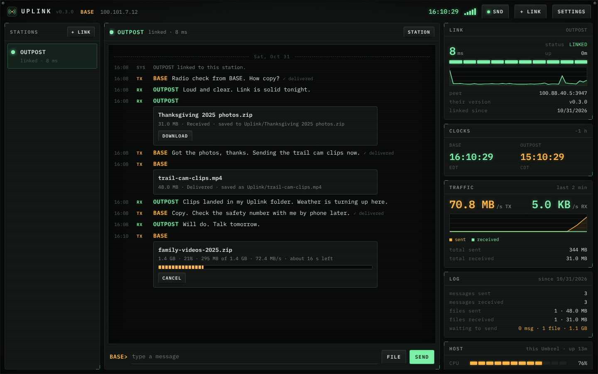
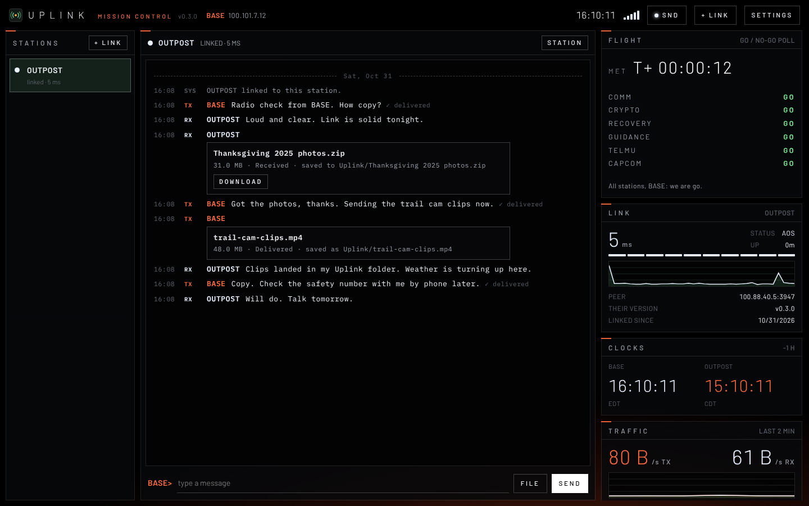
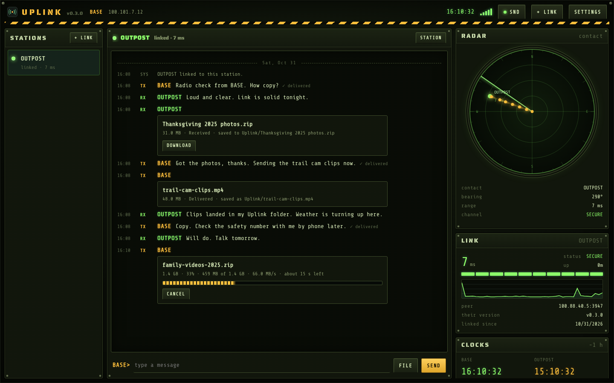
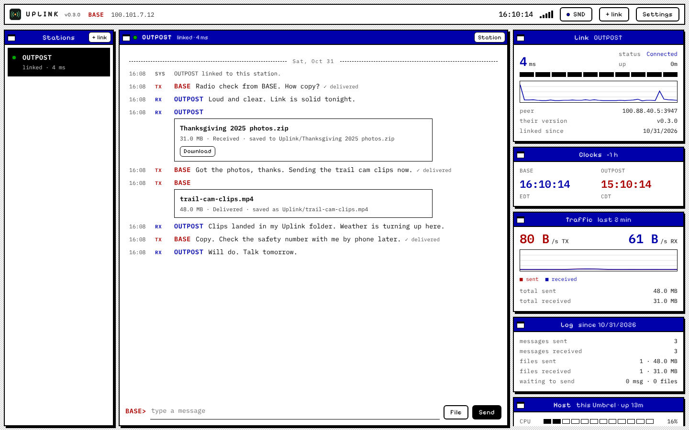
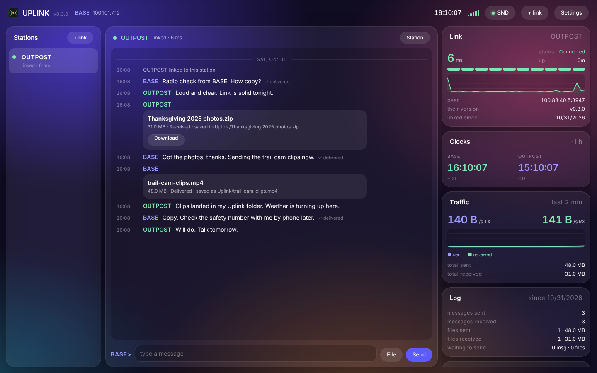
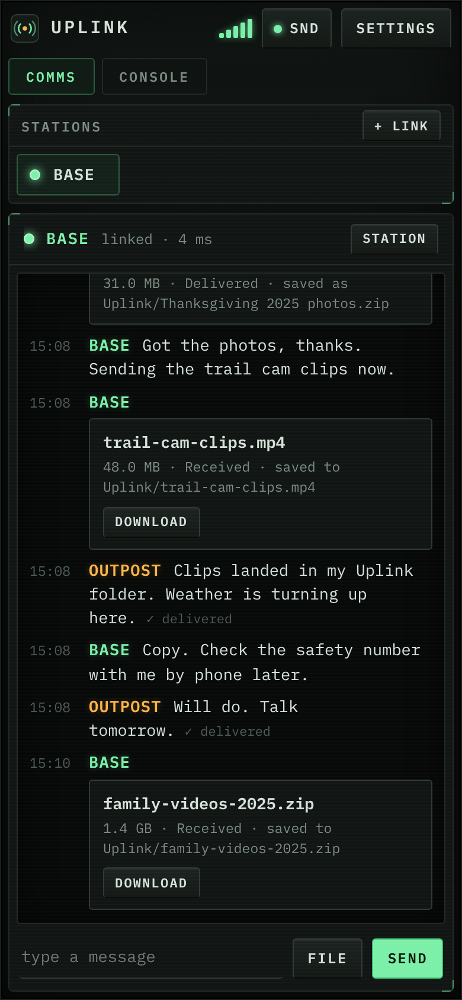
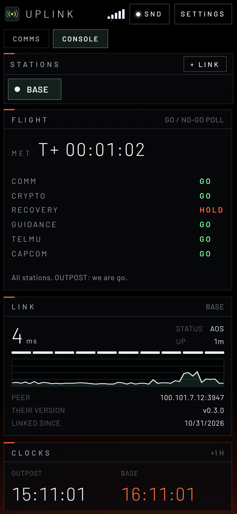
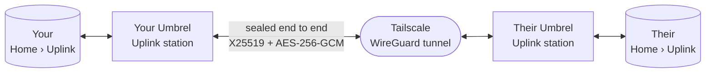
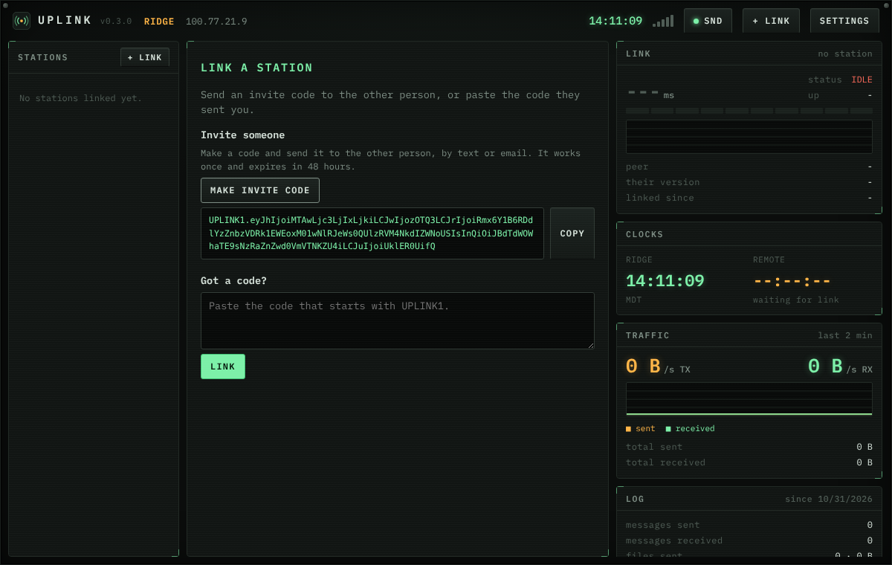

# Uplink for Umbrel

**A private, encrypted chat and file link between your Umbrel and someone else's.** Message each other and send files
of any size, straight from one Umbrel to the other. There's no company server, no account and no cloud, just two
stations and a link.



## What it does

- **Chat that waits for you.** If the other station is offline, messages queue up and are delivered when it comes
  back. Each message shows when it was delivered.
- **Files of any size.** Attach or drag and drop anything. Files travel in 4 MB encrypted pieces, pick up where they
  left off if the link drops, and are checked with SHA-256 when they arrive.
- **Files land in your Umbrel Files.** Files sent to you are saved in **Home › Uplink**. Uplink creates that folder the
  first time it starts.
- **A console of live widgets.** It shows link delay and signal history, both stations' clocks with the time
  difference, live send and receive speed, message and file counts, this Umbrel's CPU, memory and disk, and a safety
  number to check the link is private.
- **Five looks, each with its own sound effects.** Cyberdeck, Mars Mission, 1985 Desktop, Umbrel and Field Command,
  which has a live radar scope.
- **Encrypted twice.** Everything is sealed end to end by Uplink, on top of Tailscale's WireGuard tunnel.
- **Works on a phone.** On a small screen, the chat and the console become tabs.

## Looks

Pick a look in **Settings › Look**. Each look has its own sounds for sending, receiving, file transfers, errors and the
link coming up or dropping.

| | |
|---|---|
|  |  |
| **Mars Mission.** A mission-control telemetry board over the red planet. A FLIGHT widget shows mission elapsed time and runs a GO / NO-GO poll of the link, storage and host. Sends and receives use Apollo-style Quindar tones. | **Field Command.** A tactical terminal with a live radar scope. Your station sits at the centre and the other station is a contact. Transmissions fly out as amber blips and come in as green ones. Sounds include push-to-talk clicks, roger beeps and a radar ping. |
|  |  |
| **1985 Desktop.** Tiled windows, title bars and a dithered desktop. The sounds are pure PC-speaker beeps. | **Umbrel.** Frosted glass over a soft gradient, to sit right at home next to your other apps. Soft chimes. |

The default **Cyberdeck** look is shown at the top: a graphite field case with phosphor readouts, radio squelch and
modem warbles. Looks and sound settings are saved in each browser, so each person picks their own. The **SND** key in
the top bar turns sound on or off, and Settings has a volume control.

<p>
  
  &nbsp;
  
</p>

Radio operators may find something hidden.

## How it works



1. Each station makes its own key pair the first time it starts.
2. One station makes an **invite code**, and the other pastes it in. The code carries the inviting station's Tailscale
   address, its public key and a one-time token. The two stations then share a secret key that only they know.
3. Every message, file piece and status check between them is sealed with that key using AES-256-GCM. Anything tampered
   with, replayed or sent by a station you didn't link is rejected.
4. Tailscale gives both Umbrels a private network to talk over, even behind home routers and Starlink. Tailscale's
   servers help the two find each other, but never see the key or the content.

## Get started

You need two Umbrels, one for each person, and the free [Tailscale](https://tailscale.com) app on both.

### 1. Install Uplink

In the Umbrel App Store, open the **⋯** menu, choose **Community App Stores**, add this address and install **Uplink**:

```
https://github.com/PatriotCrypto/umbrel-patriot-apps
```

Both people do this.

### 2. Put both Umbrels on Tailscale

Install the **Tailscale** app from the Umbrel App Store on both Umbrels and sign in. Then pick one option:

- **One shared network (simplest).** In the [Tailscale admin console](https://login.tailscale.com), go to **Users** and
  invite the other person. They accept and sign the Tailscale app on their Umbrel in to your network.
- **Each keeps their own account.** In the admin console, open **Machines**, choose **Share** on your Umbrel, and send
  the link. The other person does the same with theirs. You need both shares, because each Umbrel contacts the other.

To stop the link from ever dropping for a sign-in, go to **Machines** in the admin console. Click **⋯** next to each
Umbrel and choose **Disable key expiry**. Otherwise Tailscale asks devices to sign in again about every six months.

### 3. Set up your station

Open Uplink and enter a station name or callsign. Then paste your Umbrel's Tailscale address, which starts with
`100.` and is shown in the Tailscale app, and press **Save**.

### 4. Link



One person presses **Make invite code**, then **Copy**, and sends the code by text or email. The other pastes it into
**Got a code?** and presses **Link**. A code works once and expires after 48 hours. When the dot next to the other
station turns green, you're linked, and you stay linked until one of you unlinks.

## Privacy and security

- **End to end.** Stations agree on a shared key with X25519 and HKDF. Every request and reply is sealed with
  AES-256-GCM and bound to its direction. Each one carries a timestamp and a one-time value, so recorded traffic can't
  be replayed. All of this runs inside Tailscale's WireGuard tunnel.
- **Check the safety number once.** Open the **Crypto** widget and read the number to each other by phone. If it
  matches on both screens, nobody is in the middle.
- **Only linked stations get in.** Uplink sits behind your Umbrel login. The one exception is the `/peer/` address the
  other station talks to, which only accepts sealed requests from stations you linked, or a single-use invite token.
- **What it doesn't cover.** Your chat history and received files are stored on your Umbrel like any other files.
  Anyone with access to your Umbrel can read them. On your home network, the page itself loads over plain http, like
  the rest of the Umbrel dashboard.
- **No cloud.** Uplink only ever talks to the station you linked.

## Where things are

| What | Where |
|---|---|
| Files sent to you | Home › Uplink in Umbrel Files. To change it, open Uplink's settings in Umbrel and choose **Storage › Received files**. |
| Chat history, keys, settings | Uplink's own app data on your Umbrel |
| Look and sound choices | Saved in each browser |
| Port | Uplink listens on 3947, and the other station reaches it at `http://<your Tailscale address>:3947` |

## Troubleshooting

- **"Could not reach … connection refused / timed out".** The other Umbrel isn't reachable over Tailscale. Check that
  both Tailscale apps are signed in to the same network, or that both Umbrels are shared with each other, and that
  Uplink is running on theirs.
- **"The other Umbrel's login page answered".** They're on an old version of Uplink, or it isn't installed. Update it on
  their side.
- **The dot went red after months of working.** One Umbrel's Tailscale sign-in probably expired. Sign it back in, and
  turn off key expiry as described above.
- **No sound.** Browsers stay silent until you've clicked or typed in the page once. Also check that the **SND** key
  shows a green lamp.
- **An Umbrel's address changed.** Uplink usually picks up the new address by itself. If it doesn't, open **Station** in
  the chat header and update it.

## Credits

Fonts: IBM Plex Mono, Barlow, Inter, Pixelify Sans, Share Tech Mono and Saira Stencil One, all under the SIL Open Font
License. Sound effects are generated live in the browser. The looks are inspired by their subjects and are not
affiliated with or endorsed by NASA, SpaceX, Microsoft, Tailscale or Umbrel.

MIT license.
