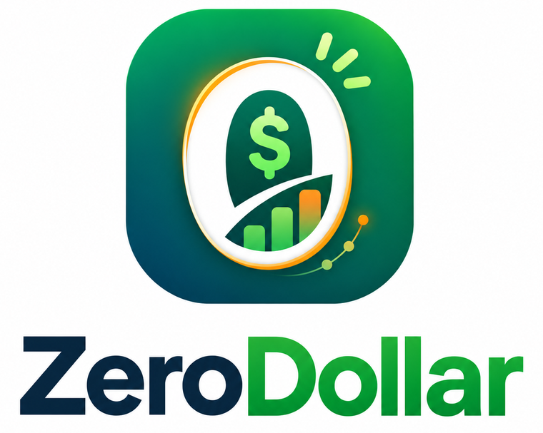

# ZeroDollar

<p align="center"></p>

A self-hosted zero-based budget for Umbrel. Give every dollar a job, log spending in seconds, and reconcile against your bank statement each month. No accounts, no cloud, no subscription.

ZeroDollar is an independent community app. It is not affiliated with, endorsed by, or connected to Ramsey Solutions, EveryDollar, or Umbrel, and it does not give financial advice.

**What it does**
- Monthly zero-based budget: income, groups and categories, "Left to budget" counting down to zero, copy last month's plan
- Quick add: a one-line entry such as `45.20 kroger groceries`, `yesterday 12 chipotle`, `+2400 paycheck`; split transactions; transfers between accounts; remembers each payee's usual category
- Bank statement reconcile: upload a CSV or OFX/QFX file; transactions are matched automatically by amount, date and payee; tips and fees are offered as suggestions; anything missing can be added in one click; manual matching for the rest; compares your balance to the bank's ending balance; duplicate uploads are detected
- Funds (sinking funds) with goals, bill due dates, debt snowball or avalanche payoff planner with payoff dates and interest saved
- Reports: spending by category, income vs. spending, net worth, top payees
- Four looks, JSON backup and restore, CSV export, daily snapshots, Umbrel home-screen widget

## Install
Umbrel Settings → App Store → ⋯ → Community App Stores → add `https://github.com/PatriotCrypto/umbrel-patriot-apps`.

## Notes
- All data stays on your Umbrel in `${APP_DATA_DIR}/data/zerodollar.json` (stored unencrypted; rely on your node's disk encryption and Umbrel login). Daily snapshots of the last 14 days are kept in `backups/`.
- Bank files are parsed on your server. PDF statements are not supported; use your bank's CSV or OFX/QFX export.
- Money is stored as whole cents. Do not expose the app port directly; Umbrel's login protects the UI.

## Development
```
cd app && npm install && DATA_DIR=./data node server.js   # http://localhost:3973
npm test
```

Bundled fonts: Inter, IBM Plex Mono and Source Serif 4 (SIL Open Font License; see `app/public/fonts`).

MIT licensed.
